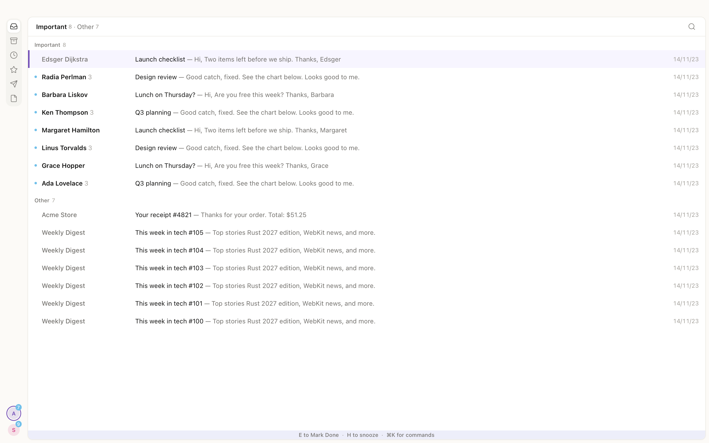

# Supermonkey

A fast, keyboard-first Gmail client for macOS, in the spirit of Superhuman.



- **Every action from the keyboard.** `j`/`k` to move, `e` to mark done, `h` to
  snooze, `r` to reply, `⌘K` for every command, `?` for the shortcut sheet.
- **Instant.** Actions change the list at once and sync to Gmail in the
  background. Mail stays readable offline, and actions taken offline go out when
  the network returns.
- **Split Inbox, snooze, undo.** Important and Other splits plus your own, snooze
  to any time, undo send, and `z` to undo the last action.
- **Unsubscribe and block.** `⌘U` unsubscribes in one step and can archive or
  trash the list's mail. Block keeps a sender or a whole domain out with a Gmail
  filter.
- **Several accounts.** Switch with `Ctrl+1`…`9`. Done, All Mail, labels, and
  search list from Gmail as well as from what is on your Mac.
- **Private.** Your mail is stored on your Mac. Messages render sandboxed with
  scripts off, and Settings can block remote images.

## Install

Download the `.dmg` from the latest
[release](https://github.com/borovikovd/supermonkey/releases/latest), open it, and
drag Supermonkey to Applications. The app is not signed yet, so clear the download
flag once before the first launch:

```sh
xattr -cr /Applications/Supermonkey.app
```

## Development

### Run

```sh
vp install
vp run tauri dev       # real Gmail; needs google-oauth-client.json (git-ignored)
vp run demo            # no Google: in-process fake Gmail with demo mail and two accounts
```

Sign in from the first-run screen or `⌘K → Add account`. Google shows an
"unverified app" warning; continue through it. While the app's Google consent
screen is in Testing, only its test users can sign in, and Google asks them to
sign in again every 7 days.

### Build

```sh
vp run tauri build     # src-tauri/target/release/bundle/macos/Supermonkey.app
```

### Release

Commit subjects follow [Conventional Commits](https://www.conventionalcommits.org)
(a commit-msg hook checks them). On each push to `main`, release-please updates a
"release X.Y.Z" pull request with the next version and the changelog, built from
the `feat`, `fix`, and `perf` subjects. Merging that pull request tags the version,
builds the universal `.dmg` in GitHub Actions, and publishes the release. Running
the Release workflow by hand builds the `.dmg` as an artifact without releasing.

### Checks

```sh
vp run gate             # every check: Rust tests, lints, type checks, bindings, then the E2E suite
vp run lint:rust        # one step (tasks are in vite.config.ts): test:rust, lint:rust, lint:ts, typecheck, bindings, e2e
vp exec playwright test # E2E suite alone (Playwright + WebKit; `vp exec playwright install webkit` once)
vp config --hooks       # once per clone: pre-commit runs `vp staged`, commit-msg runs commitlint
```

Lint setup:

- TypeScript: Oxlint through Vite+ with type-aware rules and type checking
  (`vite.config.ts`). Correctness, suspicious, and perf rules are errors, and
  warnings fail the check. `tsconfig` is `strict` with
  `noUncheckedIndexedAccess` and `exactOptionalPropertyTypes`. The React
  Compiler (the Rust port, `oxc-transform-react`) compiles every component
  except the list, which TanStack Virtual keeps out (marked in `ListView.tsx`);
  lint fails on any other component the compiler would skip.
- Rust: workspace lints in `src-tauri/Cargo.toml`. Clippy `all` is denied and
  `pedantic` is on, `unsafe_code` is forbidden, and `unwrap` is flagged
  outside tests. `rustfmt.toml` and `clippy.toml` sit next to it.

Perf fixture (two accounts × 20,000 threads):

```sh
cargo run --manifest-path src-tauri/Cargo.toml --release --features fake --bin perf-fixture -- /tmp/perf.db perf
SUPERMONKEY_DB=/tmp/perf.db vp run tauri dev
SUPERMONKEY_PERF_DB=/tmp/perf.db cargo test --manifest-path src-tauri/Cargo.toml -p sm-core --release --lib perf -- --ignored --nocapture
```

Debug builds log keydown-to-paint for each shortcut and warn when one is over
budget. `SUPERMONKEY_WEB_BRIDGE=1` serves the command surface on
`127.0.0.1:1430`, so the UI can run in a browser at `http://localhost:5173`
against the real core.

### Layout

- `src-tauri/src` — the Tauri shell, and the `e2e-server` and `perf-fixture`
  binaries.
- `src-tauri/crates`, lowest layer first: `sm-domain` (newtypes, mail model,
  views, splits, the query language), `sm-mime`, `sm-gmail` (client, quota,
  OAuth, token store), `sm-store` (schema, writer, read pool), `sm-ipc` (IPC
  types), `sm-core` (actions, subscriptions, per-account workers), `sm-bridge`
  (command dispatch for Tauri and the debug web bridge), `sm-testkit` (E2E
  server, demo, perf fixture), `sm-fake-gmail`.
- `src` — the React UI: `store/` (mirror and chrome state), `keyboard/`, `ui/`,
  `compose/`, `ipc/`. `src/bindings` is generated from `sm-ipc` by ts-rs.
- `e2e` — the end-to-end suite and its test plan, `COVERAGE.md`.

How to work on the code, for people and coding agents, is in
[AGENTS.md](AGENTS.md).

## License

[MIT](LICENSE)
